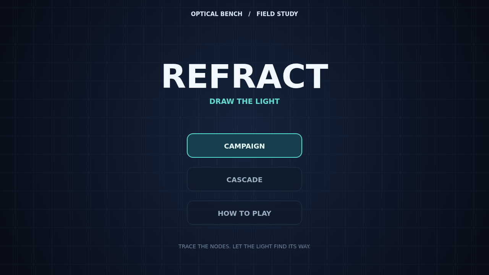

# Draw the light

Refract is a quiet, focused puzzle played on a dark optical bench. Each board is a little network of emitters, lenses, and crystals waiting for a path of light.

Press an emitter and trace a beam node by node. Reach its matching emitter and thread every lens with the same shape. You can draw in any of eight directions, and the beam follows your hand as the rules guard each move.

Crystals accept light from any channel, but their charges must be spent exactly. Routes cannot share a segment, and crossed diagonals are blocked. Invalid moves simply leave the beam where it is, so experiment by drawing and backtracking.

Campaign carries you through 24 handcrafted boards. Cascade keeps generating new boards and raises the challenge every five solves. Choose a mode, find a route, and watch the board come alive.

